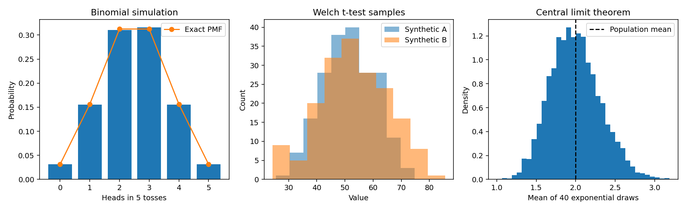

# Probability and Statistics with Python

**Nedim Omanović** · [GitHub](https://github.com/NedimOmanovic04)

Portfolio iz vjerovatnoće, statistike i analize podataka u Pythonu. Sadrži dva postojeća timska projekta — Spotify 2023 i analizu plata u data science oblasti — te dodatni pokretljiv primjer simulacije vjerovatnoće i statističkog zaključivanja.

**English:** Python statistics coursework featuring exploratory data analysis, visualizations, hypothesis testing, confidence intervals and regression. Original team contributions are credited below. A separate reproducible example demonstrates Monte Carlo simulation, a Student t confidence interval, Welch's t-test and the central limit theorem on explicitly synthetic data.

## Vještine prikazane kroz kod

| Oblast | Konkretne tehnike | Gdje pogledati |
| --- | --- | --- |
| Python i numerički rad | Funkcije, NumPy nizovi, grupisanje i transformacije | Oba notebooka i `examples/demo.py` |
| Obrada podataka | CSV učitavanje, Pandas, tipovi kolona, numeričke konverzije | Oba notebooka |
| Deskriptivna statistika | Sredina, medijana, varijansa, standardna devijacija, frekvencije | Oba notebooka |
| EDA i vizualizacija | Histogrami, scatter, bar/pie prikazi, distribucije i poređenja grupa | Matplotlib, Seaborn, Plotly |
| Testiranje hipoteza | t-test, chi-square i ANOVA | Spotify i salaries notebooki |
| Provjera distribucije | Shapiro–Wilk, Kolmogorov–Smirnov i QQ plot | Salaries notebook |
| Intervali pouzdanosti | Procjena sredine i prikaz nesigurnosti | Salaries notebook i demo |
| Regresija | LinearRegression, statsmodels OLS, MSE, R² i reziduali | Salaries notebook |
| Vjerovatnoća i simulacija | Binomna raspodjela, Monte Carlo i centralna granična teorema | Dodatni demo |
| Ponovljivost | Seed, JSON rezultati, testovi i automatizovana provjera | `examples/`, `reports/`, `tests/`, GitHub Actions |

## Projekti

### 1. Spotify 2023 — eksploratorna i statistička analiza

[Otvori notebook](notebooks/VIS24-TIM37.ipynb)

Analiza karakteristika pjesama, izvođača, streamova i prisustva na playlistama i ljestvicama. Kod uključuje deskriptivnu statistiku, grupisanje, vizualizacije i statističke testove. Istražuju se veze muzičkih karakteristika i popularnosti, te razlike između grupa pjesama.

Ulaz: `spotify2023.csv`, koji nije dostavljen u ovom folderu. Originalne ćelije koriste Google Drive putanje. Prije izvršavanja potrebno je obezbijediti odgovarajući skup podataka i prilagoditi putanje.

### 2. Data Science Salaries — plate, uslovi rada i regresija

[Otvori notebook](notebooks/VIS24-Z2-TIM37.ipynb)

Analiza plata prema iskustvu, tipu zaposlenja, lokaciji kompanije, veličini kompanije i omjeru rada na daljinu. Sadrži deskriptivne prikaze, provjeru distribucija, intervale pouzdanosti, ANOVA/chi-square/t-test primjere i linearnu regresiju sa analizom MSE, R² i reziduala.

Ulaz: `salaries.csv`. Originalni rad navodi Data Science Salaries 2023 i koristi prilagođenu tabelu koja uključuje kolonu `Sex`. Standardna javna verzija skupa ne mora imati iste kolone. Porijeklo dodatnih atributa treba provjeriti prije izvođenja zaključaka.

## Pokreni demonstraciju bez eksternih podataka

Koristi Python 3.12. Sve demonstracijske opservacije su **sintetičke** i ne predstavljaju stvarne podatke o platama ili pjesmama.

```bash
python -m venv .venv
# Windows PowerShell:
.venv\Scripts\Activate.ps1
# macOS/Linux: source .venv/bin/activate
python -m pip install -r requirements.txt
python examples/demo.py
python -m unittest discover -s tests -v
python tools/validate_notebooks.py
```

Demo obuhvata:

1. 100.000 simulacija pet bacanja poštenog novčića. Procjena `P(X ≥ 4)` poredi se s tačnom vrijednošću binomne raspodjele, `6/32 = 0,1875`.
2. Deskriptivnu statistiku za dvije nezavisne normalno generisane grupe, veličine 200 i 180.
3. 95% Student t interval pouzdanosti sredine za svaku grupu, uz uzoračku standardnu devijaciju (`ddof=1`).
4. Dvostrani Welch t-test jednakosti sredina, bez pretpostavke jednakih varijansi, pri `α = 0,05`.
5. Centralnu graničnu teoremu: 5.000 sredina uzoraka veličine 40 iz eksponencijalne raspodjele.

Seed je 42. Rezultati, veličine uzoraka i verzije biblioteka zapisani su u [statistics.json](reports/statistics.json). Za ponavljanje provjerenog demo okruženja koristi `requirements-lock.txt`.

### Izmjereni demo rezultati

Pokrenuto na Pythonu 3.12.14, SciPy 1.14.1.

| Metrika | Izmjereno |
| --- | --- |
| Tačna binomna vjerovatnoća | 0.187500 |
| Monte Carlo procjena | 0.186360 |
| Monte Carlo standardna greška | 0.001234 |
| Welch t-statistika | -1.4638 |
| Welch p-vrijednost | 0.144193 |
| Prosjek 5.000 uzoračkih sredina (teorijski: 2) | 1.9932 |

Sve vrijednosti u ovoj tabeli potiču iz sintetičkog demo primjera.




## Kako čitati statističke rezultate

- Ako je `p < α`, odbacujemo nultu hipotezu u okviru pretpostavki testa. Ako je `p ≥ α`, nema dovoljno dokaza za odbacivanje; time nulta hipoteza nije dokazana.
- P-vrijednost nije vjerovatnoća da je nulta hipoteza tačna. Statistička značajnost ne mjeri veličinu ni praktičnu važnost razlike.
- 95% interval opisuje dugoročnu pokrivenost postupka kroz ponovljene uzorke; nije tvrdnja da je vjerovatnoća fiksnog parametra u konkretnom intervalu 95%.
- Korelacija i razlike u opservacionim podacima same po sebi ne dokazuju uzročnost.
- Za poređenja plata treba koristiti zajedničku valutu (`salary_in_usd`), a za brojne parne testove razmotriti korekciju višestrukih poređenja, npr. Holm.
- U kategoriji veličine kompanije `S` znači small, `M` medium, `L` large. Za procenat rada na daljinu provjeriti kodiranje 0/50/100 prije filtriranja.

## Notebook okruženje i ograničenja izvornih analiza

```bash
python -m pip install -r requirements-notebooks.txt
python -m jupyter lab
```

Vidi [data/README.md](data/README.md) za potrebne datoteke. Notebooki su arhiva izvornog timskog rada: sačuvani ispisi i metapodaci su uklonjeni, a izvorni kod i tekstualni zaključci zadržani. Lokalno preskoči `google.colab` ćelije i prilagodi putanje; u Colabu odobri pristup samo vlastitim potrebnim datotekama.

Struktura i sintaksa notebooka su provjerene. Analize nad izvornim CSV podacima nisu ponovo izvršene jer ti podaci nisu dostavljeni. Historijske brojčane tvrdnje u tekstu notebooka zato nisu novi validirani rezultati. U izvornom radu postoje pojednostavljenja koja treba provjeriti prije ponovne upotrebe: poređenje različitih valuta, kodiranje `remote_ratio`, pretpostavke testova, višestruka poređenja i zaključci o uzročnosti. Numeričko kodiranje nominalnih kategorija može nametnuti nepostojeći poredak; za regresiju razmotriti one-hot kodiranje.

Automatizovana provjera pokreće dodatni demo i testove te provjerava strukturu i sintaksu notebooka. Ne potvrđuje metodološku ispravnost svih historijskih analiza.

## Autorstvo i timski rad

U oba dostavljena projekta kao autori su navedeni:

- Samira Ćatić
- Lina Mašović
- Nedim Omanović
- Bilal Ozdić

Repozitorij predstavlja Nedimovo učešće u timskim projektima. Iz dostavljenih notebooka nije moguće utvrditi pojedinačno autorstvo svake ćelije, pa se ne tvrdi da je cjelokupan rad samostalan. Izvorne zasluge su sačuvane.

Dokumentacija, dodatni sintetički demo, testovi i CI pripremljeni su uz pomoć AI asistenta. Izvorni fajlovi bez nastavka dobili su `.ipynb` radi ispravnog GitHub prikaza. Podaci trećih strana nisu redistribuirani i njihovi uslovi korištenja ostaju kod izvornih vlasnika.

Srodni projekat: [Artificial Intelligence Labs](https://github.com/NedimOmanovic04/artificial-intelligence-labs).
